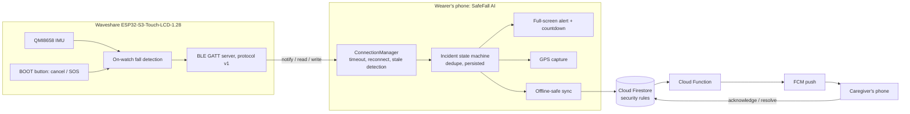

# SafeFall AI: wearable fall detection companion

SafeFall AI is an Expo (React Native, TypeScript) app that pairs with a **Waveshare
ESP32-S3-Touch-LCD-1.28** watch running SafeFall firmware. The **watch detects falls locally**
with its QMI8658 IMU. The phone presents the alert and countdown, captures location, and
notifies linked caregivers through Firebase.

> **Safety notice.** SafeFall AI is a prototype safety aid, **not a certified medical device**.
> Falls can be missed and false alarms happen. It does not contact emergency services
> automatically and is not a substitute for them.

## How it works



Incident lifecycle (`src/emergency/incidentMachine.ts`, enforced again in `firestore.rules`):

```
NORMAL → possible_fall → countdown → escalated → acknowledged → resolved
                 └──────────┴──→ cancelled
```

* **Possible fall:** the watch saw free fall plus impact. If the watch sends no follow-up
  within 20 s, the phone starts the countdown anyway (fail-safe).
* **Countdown:** default 30 s; *I'm OK, cancel* or a short press on the watch cancels it.
* **Escalated:** uploaded to Firestore. The Cloud Function pushes to caregivers. The wearer sees
  call/SMS buttons for their contacts. The app only reports what it can confirm (e.g. "accepted
  by the push service", never "delivered").
* **Acknowledged:** a caregiver tapped *I'm on it*.
* **Resolved:** closed by the wearer or a caregiver (false alarm / assisted).
* **Manual SOS:** the big red button on the dashboard (with confirmation), or a 2 s long-press on
  the watch, escalates immediately.

Incidents are persisted on the phone, so killing the app never silently loses one. An overdue
countdown escalates on the next launch. Repeated BLE packets are deduplicated by
`(device, eventId, eventType)`.

## Documentation

| Doc | Contents |
|---|---|
| [docs/AUDIT.md](docs/AUDIT.md) | Audit of the original repository (findings with file paths and severity) |
| [docs/BLE_PROTOCOL.md](docs/BLE_PROTOCOL.md) | BLE protocol v1: UUIDs, packet layouts, units, commands, timing, security, firmware status |
| [docs/FIREBASE_SETUP.md](docs/FIREBASE_SETUP.md) | Firebase project setup, data model, rules, indexes, push, offline behaviour |
| [docs/TEST_CHECKLIST.md](docs/TEST_CHECKLIST.md) | Automated / simulator / physical-device test checklist |
| [firmware/README.md](firmware/README.md) | Building and flashing the reference watch firmware |

## Project layout

```
src/
  app/                 Expo Router screens: (auth), (onboarding), (app)/(tabs), alert
  ble/                 protocol.ts (v1 codec), connectionManager.ts, plx/simulated transports
  emergency/           incidentMachine.ts (pure state machine), alertDoc.ts, labels.ts
  services/            firebase, session, sync, emergency effects, location, notifications,
                       permissions, BLE wiring, call/SMS hand-off
  store/               Zustand stores (auth, device, incidents [persisted], activity, caregiver)
  components/          UI kit (theme-based) + dashboard, map, emergency, linking, forms
  config/env.ts        typed EXPO_PUBLIC_* configuration
  __tests__/           Jest tests
firestore.rules, firestore.indexes.json, firebase.json
functions/             Cloud Function: push to caregivers on escalation
firestore-tests/       Security-rules tests (Firestore emulator)
firmware/              Reference ESP32-S3 firmware + host tests
```

## Windows setup & commands (PowerShell)

### Prerequisites
* Node.js 20 or 22 LTS, Git.
* For local Android builds: Android Studio (SDK + an emulator or a USB-debugging phone), **JDK 17**,
  and `ANDROID_HOME` set (e.g. `C:\Users\<you>\AppData\Local\Android\Sdk`).
* BLE needs a **development build**. Expo Go does not include the Bluetooth module, and the app
  says so instead of faking a watch.

### Install & verify
```powershell
git clone https://github.com/prajwallshetty/FallSense.git
cd FallSense
git checkout claude/kind-meitner-2ebrqc
npm ci
copy .env.example .env
notepad .env                 # fill in your Firebase web config (see docs/FIREBASE_SETUP.md)
npm run verify               # typecheck + lint + unit tests
```

### Run on an Android phone or emulator (development build)
```powershell
# Optional: copy google-services.json into the project root for push notifications
npx expo run:android         # builds and installs the dev client, then starts Metro
# Later sessions (dev client already installed):
npm run start:dev-client
```
To try the BLE simulator, set `EXPO_PUBLIC_ENABLE_DEV_TOOLS=true` in `.env` and restart Metro.

### Web end-to-end flow (simulator + Firebase emulators, no hardware)
See [e2e/README.md](e2e/README.md). `npm run web` also works for UI checks, but web, like Expo Go, has no Bluetooth.

### Firestore rules tests (needs Java 11+)
```powershell
cd firestore-tests; npm install; npm test; cd ..
```

### Release builds with EAS (recommended)
`.env` is git-ignored and **not uploaded** to EAS, so set the variables in EAS:
```powershell
npm install -g eas-cli
eas login
eas init                                             # creates the EAS project
eas env:create --environment production --name EXPO_PUBLIC_FIREBASE_API_KEY --value "<value>" --visibility plaintext
#   ...repeat for every EXPO_PUBLIC_FIREBASE_* value (and preview/development environments)
eas env:create --environment production --name GOOGLE_SERVICES_JSON --type file --value .\google-services.json
eas build --profile preview --platform android       # installable APK (dev tools forced off)
eas build --profile production --platform android    # AAB for Google Play (dev tools forced off)
```

### Local release build (without EAS)
```powershell
npx expo prebuild --platform android --clean
cd android
.\gradlew.bat assembleRelease     # APK: android\app\build\outputs\apk\release\app-release.apk
.\gradlew.bat bundleRelease       # AAB: android\app\build\outputs\bundle\release\app-release.aab
cd ..
```
The Expo template signs local release builds with the debug keystore. For Play Store
uploads, configure your own upload keystore
(<https://reactnative.dev/docs/signed-apk-android>) or use EAS-managed credentials.

### Deploy the backend
```powershell
npm install -g firebase-tools
firebase login
copy .firebaserc.example .firebaserc     # set your project id
firebase deploy --only firestore:rules,firestore:indexes
cd functions; npm install; npm run build; cd ..
firebase deploy --only functions
```

## Configuration

See `.env.example`. Key settings:

| Variable | Purpose |
|---|---|
| `EXPO_PUBLIC_FIREBASE_*` | Firebase web config (identifiers, not secrets) |
| `EXPO_PUBLIC_ENABLE_DEV_TOOLS` | `true` enables the BLE simulator. Forced `false` in the preview and production EAS profiles |
| `EXPO_PUBLIC_FALL_COUNTDOWN_SECONDS` | Countdown before escalation (10-120, default 30) |
| `EXPO_PUBLIC_EMERGENCY_SERVICES_NUMBER` | Shows a "Call emergency services" button (never auto-dialled) |
| `EXPO_PUBLIC_DEFAULT_COUNTRY_CODE` | Country code applied to phone numbers typed without one |

Secrets (service-account keys, SMS gateway keys) must **never** go in `EXPO_PUBLIC_*`; anything
there ships inside the APK. Server secrets belong in Cloud Functions secrets.

## Developer simulator

The simulator exists only when `EXPO_PUBLIC_ENABLE_DEV_TOOLS=true`. It emits real protocol-v1
byte packets, which pass through the same parser, dedupe and state machine as hardware.
Simulated devices and incidents are **always labelled**, never uploaded as caregiver-visible
watch status, and their incidents **never leave the phone**. A simulator pairing left over from a
dev build is discarded by builds without dev tools.

## Remaining work and known limitations

* **Background monitoring:** the BLE link is maintained while the app is foregrounded or recently
  backgrounded. Android may suspend it afterwards, so an Android foreground service is needed for
  reliable 24/7 operation (not implemented). Until then, keep the app open and exempt it from
  battery optimisation.
* **Firmware:** the reference firmware has not been compiled or flashed in CI. Verify the pins,
  IMU registers and battery divider, and **tune the fall thresholds with real recordings**. The
  display UI, touch cancel and passkey pairing are firmware TODOs (see docs/BLE_PROTOCOL.md).
* **No automatic SMS/calls:** escalation notifies caregivers by push. SMS and calls go through
  the phone's own apps when the wearer taps them.
* **iOS** builds are configured but untested.
